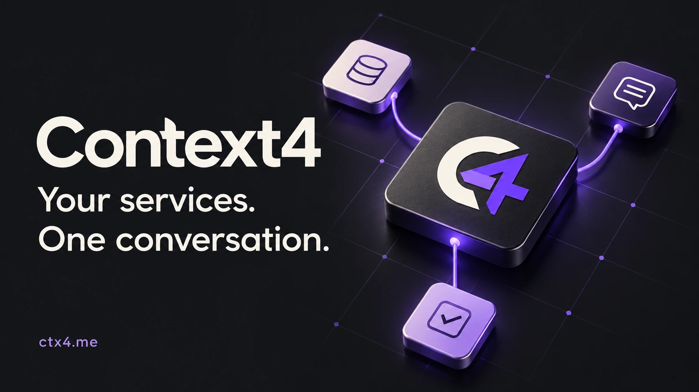
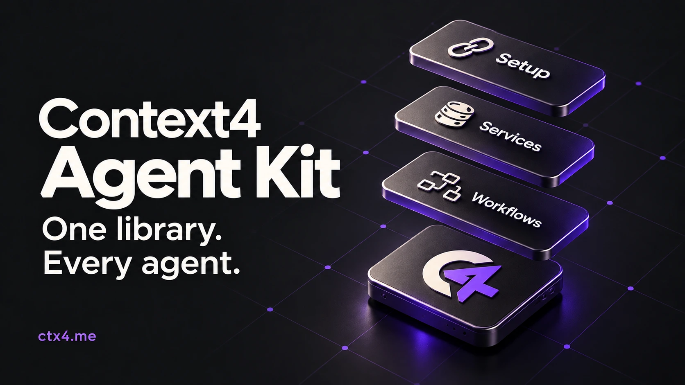

[](https://ctx4.me/?utm_source=github&utm_medium=readme&utm_campaign=mcp-presence)

# Context4 MCP — give your AI work to do

**Find the customer. Read the deal. Move the task forward.**

Connect AI assistants to CRM and business services through one hosted MCP server. Context4 gives your AI tools to find work data and carry out the actions you request in accounts you authorize.

**[Explore Context4 →](https://ctx4.me/?utm_source=github&utm_medium=readme&utm_campaign=mcp-presence)** · [Connect your AI](https://ctx4.me/connect?utm_source=github&utm_medium=readme&utm_campaign=mcp-presence) · [Browse connectors](https://ctx4.me/apps?utm_source=github&utm_medium=readme&utm_campaign=mcp-presence) · [По-русски](README.ru.md)


## Start with a task, not an integration project

| Ask your AI | Where to explore it |
| --- | --- |
| “Find overdue deals in my connected CRM and summarize the next steps.” | [amoCRM MCP](https://ctx4.me/apps/amocrm?utm_source=github&utm_medium=readme&utm_campaign=mcp-presence) · [Bitrix24 MCP](https://ctx4.me/apps/bitrix24?utm_source=github&utm_medium=readme&utm_campaign=mcp-presence) |
| “Show my team's open tasks in Linear.” | [Linear MCP](https://ctx4.me/apps/linear?utm_source=github&utm_medium=readme&utm_campaign=mcp-presence) |
| “Find this customer in my connected services and prepare a briefing.” | [Workflows and their prerequisites](https://ctx4.me/docs/business-cases?utm_source=github&utm_medium=readme&utm_campaign=mcp-presence) |

These are example requests, not reports of customer results. Available actions depend on the live catalog, connected accounts and your permissions. Check each connector's status and supported actions on the website.

## Connect once. Start with a read.

1. **[Choose your AI client on the website](https://ctx4.me/connect?utm_source=github&utm_medium=readme&utm_campaign=mcp-presence).** ChatGPT, Claude, Codex and Claude Code have dedicated guides. See the guides for client-specific availability and limitations.
2. **Sign in and connect a work account.** Complete browser OAuth and review the requested access yourself. Do not paste passwords, API keys or OAuth tokens into a chat or this repository.
3. **Ask for one read, then check the result.** For example: “Show my connected accounts, then list the tasks I can access.” Authorize changes and messages within the task you actually want performed.

| MCP connection | Value |
| --- | --- |
| Remote server | `https://ctx4.me/mcp` |
| Transport | Streamable HTTP |
| Sign-in | Browser OAuth |
| Setup and first task | [Step-by-step guide](https://ctx4.me/docs/agent-setup?utm_source=github&utm_medium=readme&utm_campaign=mcp-presence) |

For direct MCP setup, follow your client's [connection guide](https://ctx4.me/connect?utm_source=github&utm_medium=readme&utm_campaign=mcp-presence). Plugins below bundle the connection with reusable skills; you do not need to run a local Context4 server.

## Keep exploring on Context4

The website holds the full, maintained documentation. This repository holds installation instructions and the public plugin packages.

| What you need | Read on the website |
| --- | --- |
| Understand the product | [What is Context4?](https://ctx4.me/docs/product-overview?utm_source=github&utm_medium=readme&utm_campaign=mcp-presence) |
| Find a supported business service | [Connector catalog](https://ctx4.me/apps?utm_source=github&utm_medium=readme&utm_campaign=mcp-presence) |
| Combine services in one task | [Business workflows](https://ctx4.me/docs/business-cases?utm_source=github&utm_medium=readme&utm_campaign=mcp-presence) |
| Understand tools and dynamic discovery | [MCP tool reference](https://ctx4.me/docs/mcp-tools?utm_source=github&utm_medium=readme&utm_campaign=mcp-presence) |
| Review access and disconnect | [Access guide](https://ctx4.me/docs/access-and-disconnect?utm_source=github&utm_medium=readme&utm_campaign=mcp-presence) |
| Understand data handling | [Data handling](https://ctx4.me/docs/data-handling?utm_source=github&utm_medium=readme&utm_campaign=mcp-presence) |
| Check current service terms | [Pricing](https://ctx4.me/pricing?utm_source=github&utm_medium=readme&utm_campaign=mcp-presence) · [Privacy](https://ctx4.me/privacy) · [Terms](https://ctx4.me/terms) |

## Install a plugin or skills

This public repository contains three product skills, a plugin and marketplace for Codex and Claude Code, OpenAI plugin metadata, and a local skills installer. It contains no service backend or account credentials.

## Codex plugin

```sh
codex plugin marketplace add context4/plugins
codex plugin add context4@context4
codex plugin list --json
```

Codex supports this repository's `.claude-plugin/marketplace.json` compatibility format. The installed plugin includes all three skills and the `https://ctx4.me/mcp` connection configuration. Restart Codex after installation and complete browser OAuth when it requests Context4 authorization. Installation does not grant access to a Context4 account by itself.

For a pinned installation, use `codex plugin marketplace add context4/plugins --ref v1.2.1` as the first command. Installation of this release was verified with an isolated Codex configuration: the plugin was installed and enabled, with all three skills and the MCP endpoint present. See the [OpenAI packaging documentation](https://developers.openai.com/plugins/build/plugins#add-a-marketplace-from-the-cli) for marketplace support.

## Claude Code plugin

```sh
claude plugin marketplace add context4/plugins
claude plugin install context4@context4
```

This installs the skills and declares `https://ctx4.me/mcp`. Complete browser OAuth when Claude asks. File installation and account authorization are separate steps.

## Skills installer

Use the installer when you want skill files in a specific client directory. Requires Node.js 22+ and Git. Run in your project directory. The npm registry package is not published; these commands use the versioned GitHub source.

```sh
npx --yes --package=github:context4/plugins#v1.2.1 context4-skills install --agent claude
npx --yes --package=github:context4/plugins#v1.2.1 context4-skills install --agent codex
```

Add `--global` for your user account. Supported destinations:

| Agent | Project | Global |
|---|---|---|
| Claude Code | `.claude/skills` | `~/.claude/skills` |
| Codex | `.agents/skills` | `~/.agents/skills` |
| Cursor | `.cursor/skills` | `~/.cursor/skills` |
| Hermes | explicit `--dir` | `~/.hermes/skills` |
| OpenClaw | workspace `skills` | `~/.openclaw/skills` |

```sh
npx --yes --package=github:context4/plugins#v1.2.1 context4-skills install --agent hermes --global
npx --yes --package=github:context4/plugins#v1.2.1 context4-skills install --agent openclaw --global
npx --yes --package=github:context4/plugins#v1.2.1 context4-skills install --agent cursor --lang ru
npx --yes --package=github:context4/plugins#v1.2.1 context4-skills install --dir ./my-agent/skills
npx --yes --package=github:context4/plugins#v1.2.1 context4-skills update --agent claude
npx --yes --package=github:context4/plugins#v1.2.1 context4-skills remove --agent claude
```

Use the same destination flags for update and remove. `--lang en` is the default; `--lang ru` selects Russian instructions. To update the release, explicitly select a newer GitHub tag. Restart your agent after changing its skills.

The installer records hashes for its files and refuses to overwrite unowned directories or local edits, missing files, added files and symlink destinations. It does not change MCP configuration or create credentials. Use `--dir` for another agent's documented skill directory. If a process is interrupted, inspect the lock's backup, staging files, skill directories and ownership receipt before removing `.context4-skills.lock`; do not restore files blindly.

## Hosted Claude and ChatGPT

The CLI cannot install into a hosted account. [Releases](https://github.com/context4/plugins/releases) provide `claude-plugin.zip`, portable OpenAI `plugin.zip`, and individual English/Russian skill ZIPs. Use the client's supported upload flow. Claude directory submissions use this repository's `plugins/context4` folder. Directory approval is separate from personal installation.

For MCP access, configure `https://ctx4.me/mcp` and complete OAuth. [Client setup](https://ctx4.me/docs/agent-setup.md) explains authorization. Skills without a working connection cannot access services.

## Contents and maintenance

- `context4`: select accounts and discover exact tool schemas.
- `context4-setup`: configure a client and verify the first connection.
- `context4-workflows`: complete tasks across connected services.

Canonical English skills and both platform manifests live in `plugins/context4`; Russian translations in `locales/ru`. Codex reads the portable `plugin.json` and `mcp.json` directly from that directory, including its presentation and setup onboarding skill. The installer and archives use those same files. Claude Code uses the compatible `.claude-plugin/plugin.json` and `.mcp.json` in the same directory.

```sh
npm ci
npm run check
claude plugin validate .
claude plugin validate plugins/context4
```

The release script produces eight deterministic ZIPs and SHA256 metadata in `dist`. Tests exercise real temporary directories, conflict protection and archive equality. `private:true` prevents accidental npm publication; it does not make this GitHub repository private.

The public package, installer and release tooling are MIT licensed. Existing skill licenses and upstream attribution are retained. Hosted use is governed by [terms](https://ctx4.me/terms) and [privacy](https://ctx4.me/privacy).

[Support](https://ctx4.me/support) · [Documentation](https://ctx4.me/docs/agent-setup.md).

## Agent Kit source and selective installation

[](https://ctx4.me/docs/skills?utm_source=github&utm_medium=readme&utm_campaign=mcp-presence)

This repository now owns the canonical skill library for client plugins, standalone skill installation, marketplace archives and the website. `skills/`, `locales/ru/`, `catalog.json`, `packaging/`, `profiles/` and `assets/` are editable inputs. `plugins/context4/` is a committed generated projection for native Git marketplace installation. Do not edit it directly: run `npm run generate`, commit the projection, then run `npm run check`. CI checks the complete generated inventory, including extra files.

The selective installer is available from this development checkout; the pinned v1.2.1 commands above retain their original all-skills behavior. A v1.3.0 tag or npm publication is not implied by this branch.

```sh
node src/cli.mjs list --json
node src/cli.mjs install context4-workflows --agent codex --dry-run
node src/cli.mjs install context4-workflows --agent codex
node src/cli.mjs update context4-workflows --agent codex
node src/cli.mjs remove context4-workflows --agent codex
```

Selection includes declared dependencies. With no skill IDs, install retains the existing all-skills behavior; update/remove act on the owned installed roots. `--lang ru` applies to selected roots and their new private dependencies. Unselected skills retain their bytes, language and release identity. Shared dependency replacement requires selecting all affected roots. `--source /path/to/skills-source.json` selects a local, versioned neutral release artifact for install/update; removal uses only local ownership and works offline for retired IDs. Only use artifacts from a trusted release; a matching digest does not authenticate an unknown publisher.

Receipt v2 stores roots and per-skill version, language, source identity, exact dependencies and installed hashes. Legacy v1 receipts migrate during mutation; unavailable legacy source provenance is explicitly recorded, never invented. Locally modified files and unowned directories are not overwritten. An interrupted transaction retains a journal and backups for recovery on the next command. A legacy lock or interrupted recovery may require inspection before retrying.

A DeepSeek-backed Codex session uses the Codex profile; the model name does not define a new skills directory. Other DeepSeek hosts can use their documented directory through `--dir`. Installation, native plugin validation and real account/MCP authorization are separate checks.

`npm run build` creates eight ZIP packages plus `skills-source.json` and a checksum manifest. The neutral snapshot carries the canonical catalog, localized sources, plugin manifests and assets. The website and a future embedded agent can pin that snapshot by release and digest without invoking the CLI. The website renders its own locale and deployment origins; product runtime authorization remains outside this public package.

Author a connector skill by adding its source files and localized references, then register its stable ID, localized labels, version, allowlisted files and exact dependencies in `catalog.json`. Use live Context4 discovery rather than copying private account details or stale tool schemas. Eval cases remain in the canonical source tree but are excluded from installed files and release ZIPs.
